

# 🏕️ Three in the Wild

**Ein Low-Poly-Campingausflug zu viert: Angeln, Wandern, Chili kochen, Überleben.**
Solo spielbar, Mehrspieler bis 4 Personen, läuft direkt im Browser.

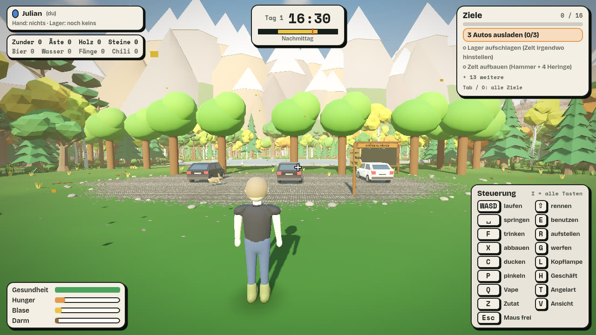

Drei Freunde (Julian, Steffen, Marian) kommen mit ihren Autos zum See. Sie laden aus, schlagen das Lager auf, machen Feuer, angeln, kochen Chili con Carne und erkunden die Gegend. Dabei müssen sie auf Gesundheit, Hunger und ihre Blase achten. Alles ist Low-Poly, alle Geräusche sind entweder echte Aufnahmen oder per Code erzeugt.

## ✨ Features

- **Angeln mit 7 Fischarten:** Karpfen, Hecht, Rotauge, Barsch, Brasse, Riesenwels und Aal, mit Grund-, Posen- und Spinnangeln, Rutenständer, Drill-Minispiel (Rute per Maus gegen den Zug neigen) und einer **Bestenliste** mit Fisch-Bild am Parkplatz.
- **Tag/Nacht und Wetter:** Ein Spieltag dauert ca. 17 Minuten. Es gibt Sonne, Wolken, Regen, Gewitter (Blitz und Donner) und Nebel. Nachts kommen Glühwürmchen und das Nutria.
- **Camp-Gefühl:** Zelt mit Heringen, Feuerschale, Grill, Dutch Oven, Kühlbox, Hängematte, Campingstühle und ein **Radio mit echten Internet-Radio-Streams** (Lautstärke für alle gemeinsam einstellbar).
- **Survival:** Hunger, Blase, Darm, Gesundheit, Promille. Zu spät aufs Klo? Die Hose verfärbt sich sichtbar und kostet Gesundheit. Hunger über 100 % führt zum Tod, danach heißt es: Bier ins Camp tragen, bevor wieder geangelt wird.
- **Nahrung überall:** Pilze (Achtung, Giftpilze), Beeren und Äpfel wachsen über die ganze Karte nach.
- **Erkunden:** Ein schwerer Kletterweg zum Aussichtspunkt, Höhlen, Hütte, Verstecke mit Schatzkisten, Fallen (Bärenfalle, Fallgrube, Wespennest, Steinschlag).
- **Tiere:** Schwäne, Enten, Frösche, Rehe, Hasen, Singvögel, Fische. Mit dem Luftgewehr (Magazin, Nachladen, Zielen) kann man sie erlegen, das Blut bleibt als Lache liegen.
- **Ziele mit Übersicht:** 16 Ziele mit Fortschrittsbalken, Meldung beim Erreichen und einer Gesamtübersicht (Tab).
- **Mehrspieler:** WebSocket-Server, Mitspieler laufen sichtbar mit, gemeinsame Zeit, gemeinsame Nacht (alle im Zelt oder in der Hängematte = Nacht wird übersprungen).

## 🖼️ Screenshots

| | |
|---|---|
| 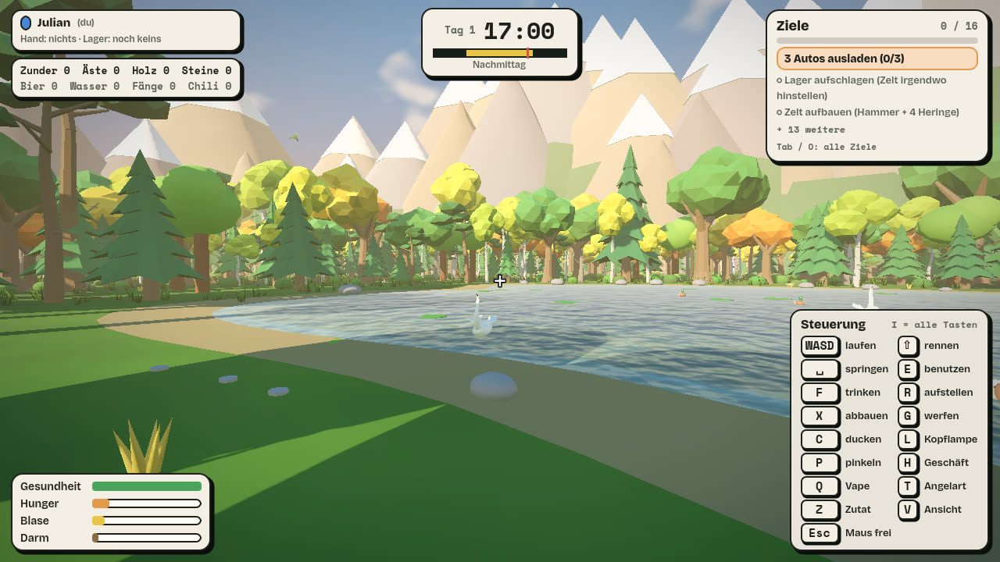 | 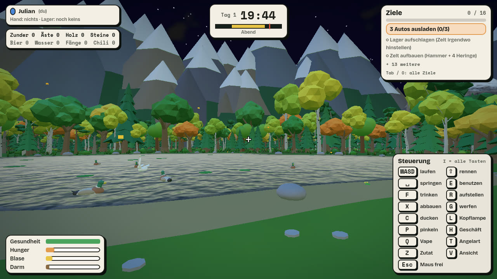 |
| **Schwan und Enten auf dem See** | **Abendlicht** |
| 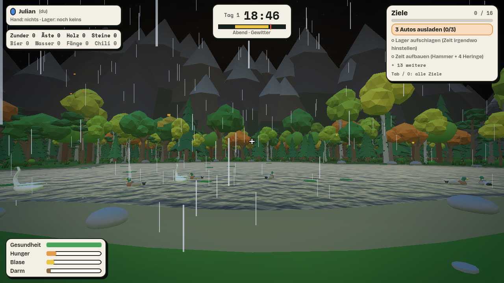 | 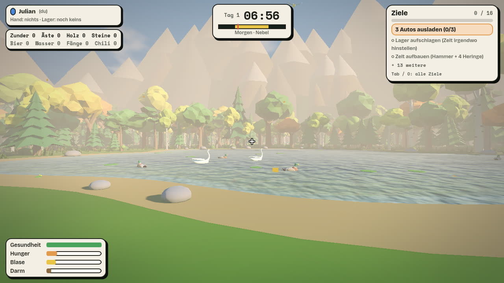 |
| **Gewitter mit Regen** | **Nebel am Morgen** |
| 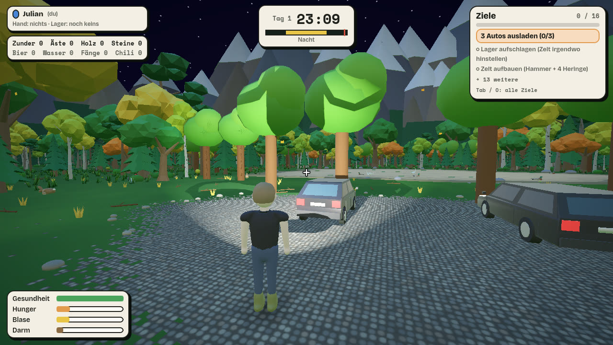 | 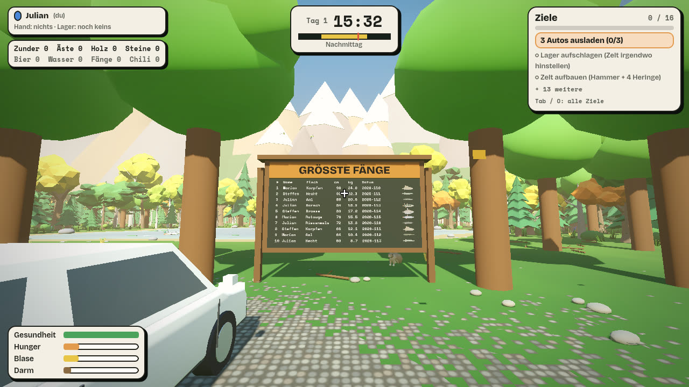 |
| **Nacht mit Kopflampe** | **Bestenliste mit Fisch-Bildern** |

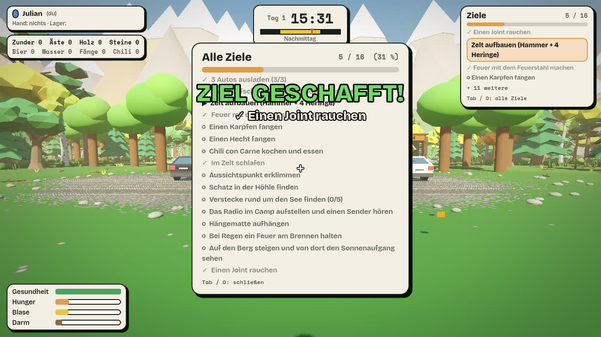
*Alle 16 Ziele auf einen Blick (Tab oder O), dazu die Meldung beim Erreichen.*

## 🎨 Modelle aus Blender

Alle Figuren, Tiere, Fische und Gegenstände sind eigene Low-Poly-Modelle (Blender, Export als glTF).

| | |
|---|---|
| 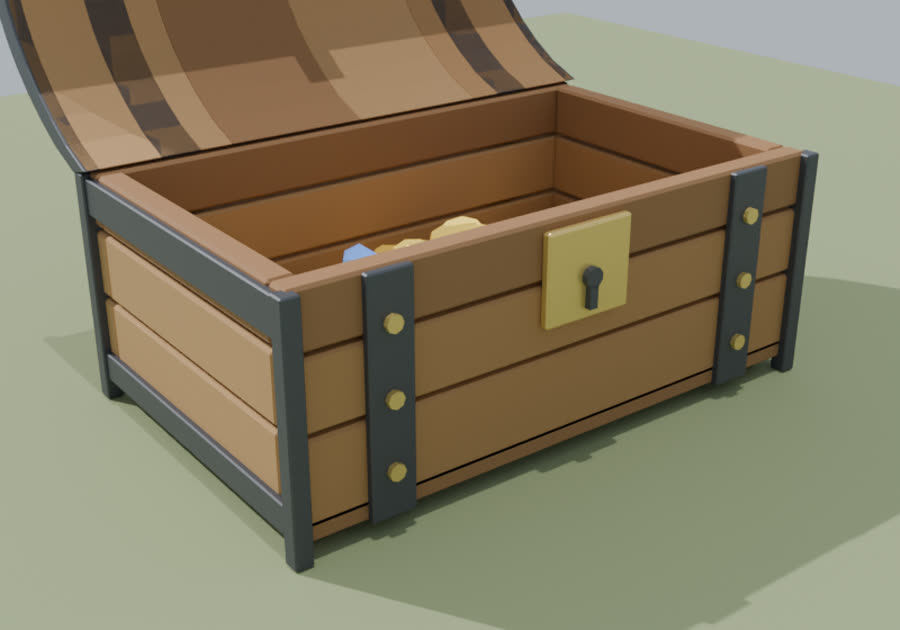 | 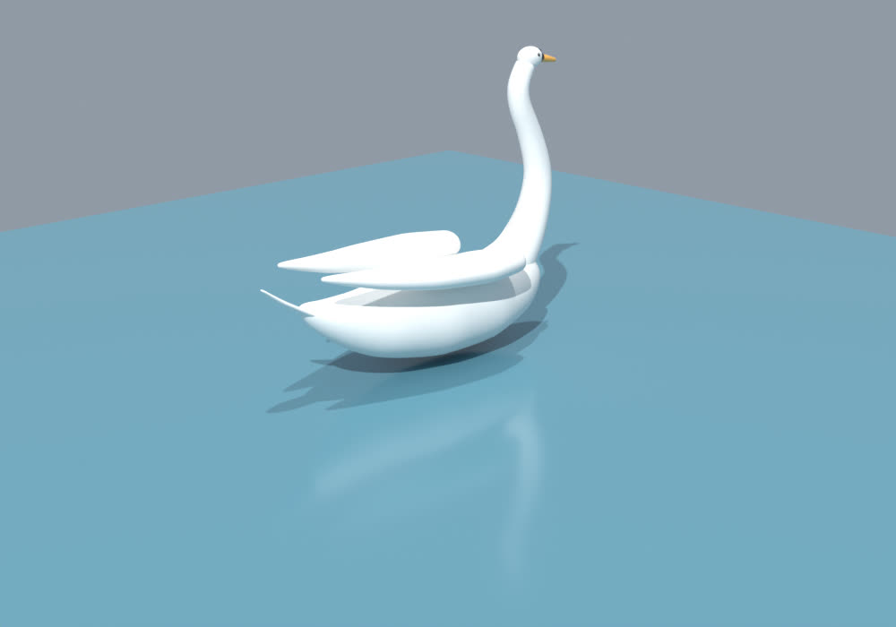 |
| **Schatztruhe mit Öffnungsanimation** | **Schwan (Schwimm-, Ruhe- und Putzanimation)** |
| 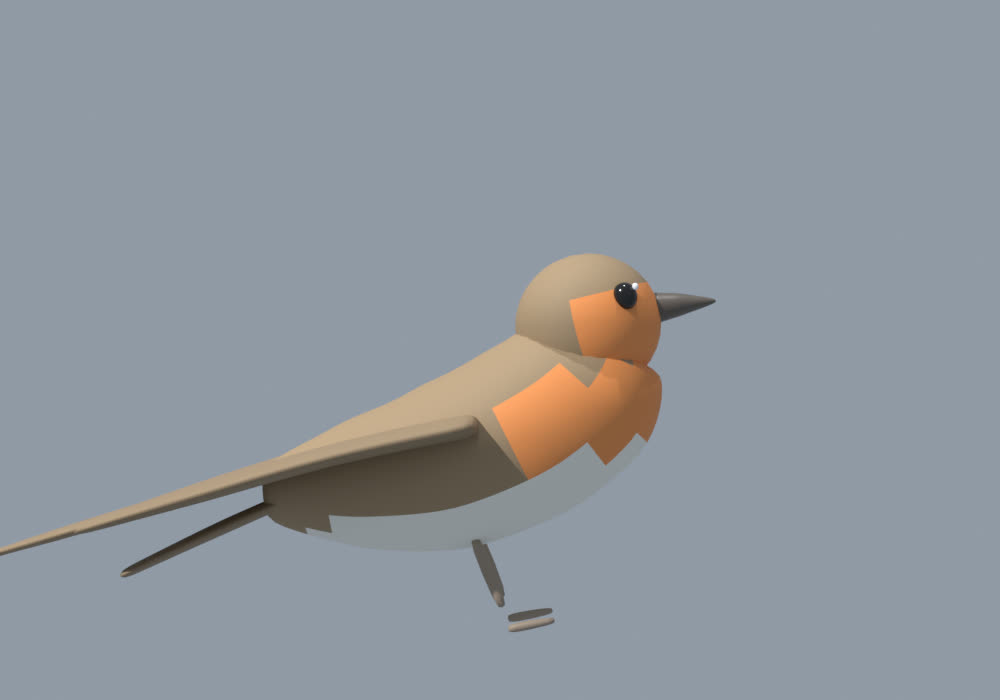 | 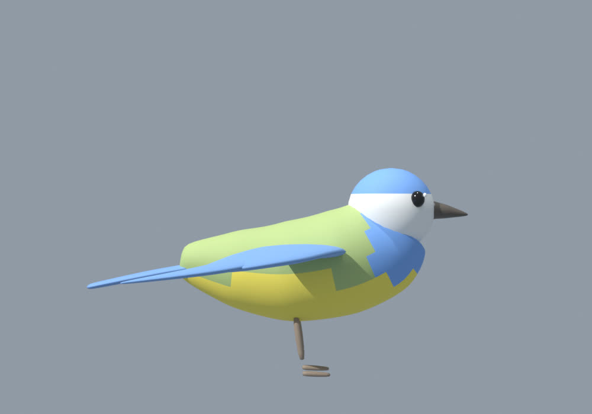 |
| **Rotkehlchen (Flug- und Ruheanimation)** | **Blaumeise** |

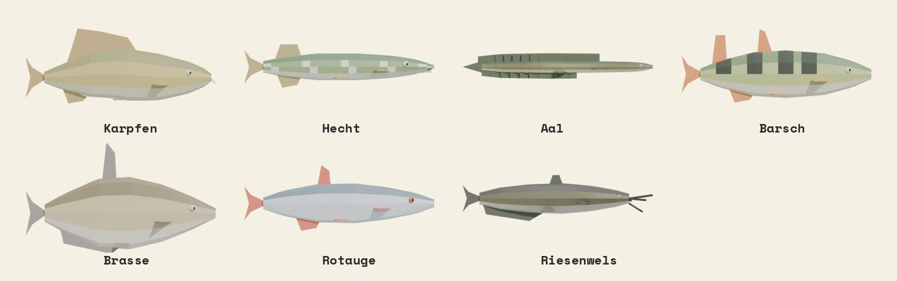
*Die sieben Fischarten, wie sie auch im Spiel als Fang und auf der Bestenliste erscheinen.*

## 🚀 Schnellstart

**Zum Entwickeln/Spielen am PC:** Projekt in Godot 4.3 öffnen (`project.godot` importieren) und F5 drücken. Es werden keine externen Assets gebraucht. Beim Start erscheint das Menü: Name, Charakter, Solo / Hosten / Beitreten.

**Im Browser:** Der Ordner `web/` enthält die fertig exportierte Web-Version (Compatibility-Renderer, ohne Threads). Mit einem beliebigen Webserver ausliefern (`python3 -m http.server` im Ordner `web`), oder den Server unten nutzen.

**24/7-Server:** Per Docker (Unraid, Cloudflare Tunnel), siehe [SERVER.md](SERVER.md) und `docker-compose.yml`. Freunde öffnen die Adresse im Browser, geben das Passwort ein und spielen, ohne Installation.

## 🎮 Steuerung

| Taste | Aktion | Taste | Aktion |
|---|---|---|---|
| WASD | laufen | Shift | rennen |
| Space | springen | C / Strg | ducken |
| E | benutzen / aufheben | F | trinken / Radio an-aus |
| R | aufstellen | X | abbauen |
| G | werfen / Stein flitschen | L | Kopflampe |
| P | pinkeln (halten) | H | großes Geschäft (tief im Wald) |
| Q | Vape (Julian) | T | Angelmethode |
| Z | Zutat / Radio-Sender | V | Ego / Third Person |
| Tab / O | alle Ziele | I | alle Tasten |
| +/− / Mausrad | Radio-Lautstärke | 1/2/3 | Charakter |

Angeln: **Linksklick** auswerfen und anschlagen, **Linksklick halten** einholen, **Rechtsklick** Schnur einholen. Beim Drill die Rute **per Maus gegen den Zug neigen** (gibt einen Bonus, ohne ist es aber kein Fehler).

## Spielablauf im Detail
1. **Autos ausladen**: Heckklappe von Lupo, Passat und Polo öffnen (E). Das Gepäck purzelt heraus.
2. **Lager**: Angelplatz ist überall. Dort, wo du das erste Zelt aufstellst (Zeltpaket, R), ist euer Lager (grüner Ring). Gegenstände lassen sich aber überall auf der Karte aufstellen, auch ohne Zelt (nur nicht im Wasser).
3. **Aufbauen** (Gegenstand tragen, R): Zelt (Hammer in die Hand, 4 Heringe), Feuerschale, Grill, Dutch Oven (auf den Grill zielen), Stühle, Kühlbox, Bierkasten, Wasserkanister, Brennholz, Rucksack. X baut ab.
4. **Feuer**: Zunder (gelbe Büschel) und Äste im Wald einsammeln (E), in die Feuerschale legen (Zunder 3, Äste 4), Feuerstahl in die Hand, E. Dann läuft ein **Treffer-Balken**: E drücken, wenn der Strich im grünen Feld ist (4 Treffer, Fehlschlag kostet einen Treffer). Marians grünes Feld ist 20 % kleiner, er flucht bei Fehlschlägen, sein Feuer brennt dafür länger. Holzscheite vom Brennholz-Bündel nachlegen.
5. **Angeln (vom Ufer, kein Steg mehr)**: Jeder hat eine eigene Rute (Marian grün, Steffen rot, Julian blau, Gast gelb). Rute in die Hand. T = Methode (Grund / Pose / Spinn), Linksklick = auswerfen, bei Biss Linksklick = anschlagen, dann Linksklick halten zum Einholen (bei Fluchten loslassen, sonst reißt die Schnur). Karpfen beißen nachts am Grund (Bissanzeiger piept), Hecht beim Spinnangeln. Rechtsklick = Schnur einholen. Nicht in den See pinkeln!
   **Rutenständer**: Rute auswerfen (Grund oder Pose), dann mit der Rute in der Hand auf einen aufgestellten Rutenständer zielen und E: die Rute bleibt draußen, du baust das Lager weiter auf. Beißt etwas, piept der Ständer und meldet es. E am Ständer = Rute nehmen und mit Linksklick anschlagen. Auch im Schlaf kann es an der Rute im Ständer beißen.
6. **Chili con Carne**: Rucksack aufstellen, Zutaten einzeln nehmen (E, Z wechselt die Zutat) und in den Dutch Oven auf dem angezündeten Grill kippen. Rezept: Zwiebeln, Hackfleisch, Knoblauch, Tomatenmark, Gehackte Tomaten, Kidneybohnen, Mais, Paprika, Gewürze. Umrühren (E) gegen Anbrennen, nach der letzten Zutat 30 s köcheln. Steffen kocht schneller und rührt besser.
7. **Schlafen**: Zelteingang (E), ab 19 Uhr. Solo spult das die Nacht vor, im Mehrspieler legt man sich hin, und sobald alle im Zelt oder in der Hängematte liegen, ist die Nacht vorbei. Es kann ein Fisch an der Grundrute anbeißen (dann ist Action) oder ein Nutria am Zelt rascheln.
8. **Nutria**: kommt abends/nachts, klaut Zutaten aus dem Rucksack und knabbert an der Kühlbox. Geh auf es zu, dann flieht es und lässt die Beute fallen. Ein brennendes Feuer hält es auf Abstand.
9. **Wandern** (Osten, hinter dem Wald): Der Aussichtspunkt (15 m) ist nur über eine SEHR schwere Kletterroute rund um den Fels erreichbar: 34 Plattformen mit Lücken (Anlauf mit Shift!), schmale Balken, kleine Steine und Hindernisse. Ein Fehltritt = tiefer Fall mit viel Schaden, Höhle mit zwei Eingängen (Kopflampe L!), Kristalle, ein Loch im Boden und eine Schatzkiste (Glücksköder).
10. **Hängematte**: Aus dem Auto (Lupo). Hängematte in die Hand, vor einen der Bäume stellen, E. Dann E = reinlegen (Gesundheit erholt sich), WASD = aufstehen, X = abbauen.
11. **Verstecke und Fallen rund um den See**: Fuchsbau (Höhle, West), Jagdhütte (Nordwest), Tropfsteinhöhle mit Kristallen (Nord), Hohler Baum (Nordost), Steinlager (Ost). Je eine Kiste mit Beute (Notration, Verbandskasten, Goldköder, alte Karte mit Hinweis, Bier). Dazu Fallen: **Bärenfalle** (klemmt fest, E mehrfach drücken), **Fallgrube** (morsche Äste), **Stolperdraht** mit Steinschlag (schnell wegrennen), **Wespennest** (nicht zu nah ran). Fallen kann man mit E entschärfen, wenn man sie sieht. Pilze: braune sind lecker, rote sind giftig. Beeren sind harmlos.
12. **Wasser**: Man kann in den See waten und schwimmen (langsamer; Fische werden vertrieben). Flache Steine am Ufer wie Äste einsammeln (E), mit G auf den See flitschen.
13. **Tiere**: Schwäne, Enten und springende Fische im See, Frösche am Ufer (nachts quaken sie), Rehe und Hasen im Wald (flüchten), Rotkehlchen und Blaumeisen am Himmel, nachts Glühwürmchen. Mit dem Luftgewehr (Magazin, R nachladen, Rechtsklick zielen) kann man Tiere erlegen.
14. **Großes Geschäft** hinterlässt einen Haufen (mit Fliegen). E = vergraben. Wer hineintritt, stinkt 90 s (im See abwaschen).

## Zeit
Tageszeit steht oben in der Mitte. Ein Spieltag dauert wie in Minecraft ca. 17 Minuten (Tag 10, Nacht 7).

## Bedürfnisse
Gesundheit, Hunger, Blase, Darm-Barometer (füllt sich zufällig schnell oder langsam). Das Darm-Barometer füllt sich etwa einmal pro Spieltag, schneller nach Bier und Chili. Voll = dringend in den Wald (mindestens 22 m vom Lager, nicht am See/Parkplatz). Bier macht betrunken (Torkeln, Kamerawackeln, Stolpern, Unschärfe), Wasser hilft etwas.

## Mehrspieler (bis zu 4, Platz 4 heißt "Gast")
Übers Internet: Alle installieren Tailscale (kostenloses VPN) und melden sich im selben Tailnet an. Einer wählt "Hosten", die anderen "Beitreten" mit der Tailscale-IP des Hosts (100.x.x.x), Port 24680 (TCP, WebSocket). Im selben WLAN reicht die lokale IP.
Synchronisiert: Mitspieler (Figur, Name, Position, Animationen, Hosen-Verfärbung), Tageszeit, Wetter, Lagerwahl, Zelte, aufgestellte Gegenstände, Radio (an/aus, Sender, Lautstärke), Abschüsse samt Blutlache, Bestenliste, Schlafen.
Noch NICHT synchronisiert: herumliegende/getragene Gegenstände, Feuer- und Kochtopf-Zustand, Fische im Drill, Nutria, Tiere (jeder Spieler simuliert sie lokal), Fallen, Pilze, Kackhaufen.

## Dateien
`main.gd` (Welt, Tag/Nacht) · `player.gd` · `needs.gd` (Hunger, Blase, Tod) · `fisher.gd` (Angeln, Drill) · `fauna.gd` (Tiere) · `weather.gd` · `radio.gd` · `placed_item.gd` / `item.gd` / `item_models.gd` (Gegenstände) · `massif.gd` (Berg, Höhle) · `hideouts.gd` (Verstecke, Pilze) · `trap.gd` · `stash.gd` (Kisten) · `leaderboard*.gd` · `net.gd` (Mehrspieler) · `sfx.gd` (Geräusche) · `hud.gd` / `ui.gd` · `menu.gd` und weitere. Modelle liegen in `assets/` (glTF), Doku-Bilder in `docs/img/`.

## Lizenz und Dank
Ein Hobbyprojekt, gemeinsam mit Claude entwickelt. Schriften: Bricolage Grotesque und Space Mono (OFL). Die Radiosender gehören ihren jeweiligen Betreibern, es werden nur öffentliche Streams abgespielt.
